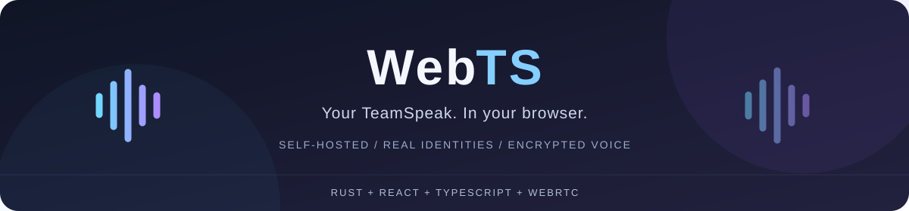
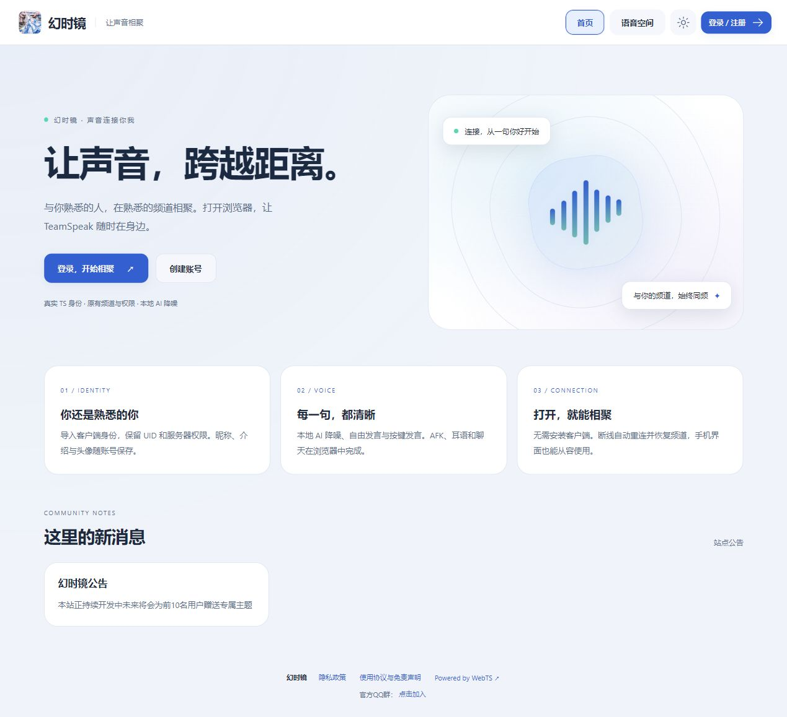
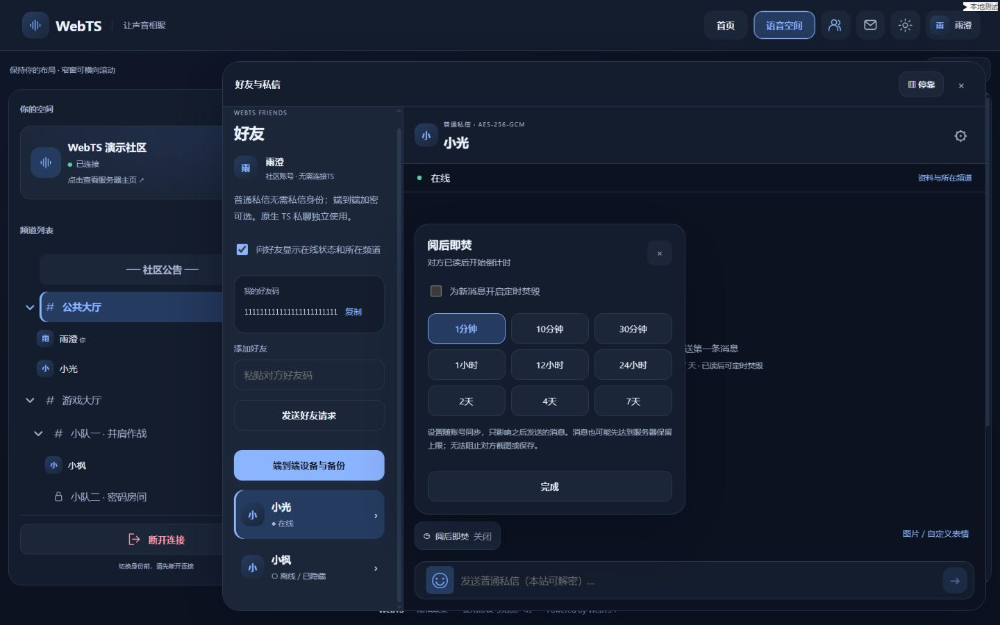
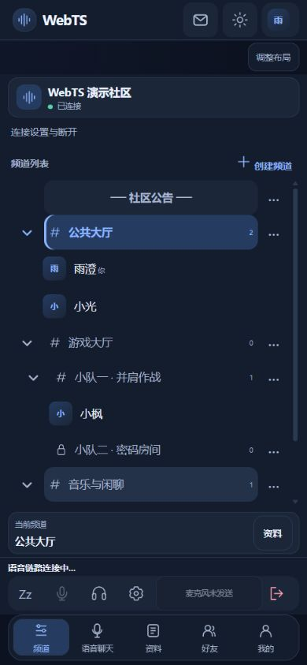

<div align="center">



**把熟悉的 TeamSpeak 频道，带进浏览器。**

自托管 · 便捷账号登录 · 多个真实身份 · 权限继承 · 加密语音

[](LICENSE)
[](server)
[](web)
[](web)
[](https://github.com/PTPHAP/WebTS/actions/workflows/check.yml)

[安装教程](docs/INSTALL.md) · [配置教程](docs/CONFIGURATION.md) · [使用说明](docs/CLIENT.md) · [支持范围](docs/SUPPORT.md) · [好友加密私信](docs/FRIENDS.md) · [隐私政策](PRIVACY.md)

</div>


WebTS 让你在浏览器里使用 TeamSpeak：登录账号、选一个身份，就能进入熟悉的频道和朋友说话。支持电脑和手机界面，保留身份原来的 TS 权限。

## 你想做什么？

| 你的情况 | 看这里 |
| --- | --- |
| 朋友已经搭好网站，我只想使用 | 打开朋友给的网址，[按使用说明登录和连接](docs/CLIENT.md)；无需安装节点 |
| 我想搭建一个自己的 WebTS 网站 | [Linux / Docker 安装](docs/INSTALL.md) · [Windows 安装](docs/WINDOWS.md) |
| 我已有 WebTS 网站，想让语音直接到 TS 所在机器 | [安装语音节点](docs/NODE-INSTALL.md)，装在运行 TeamSpeak 的那台服务器 |
| 我已经装好了，想改邮箱、服务器或站点名称 | [安装后的配置](docs/CONFIGURATION.md) |

**当前可下载版本：[1.1.0](https://github.com/PTPHAP/WebTS/releases/tag/v1.1.0)。** 安装教程只使用已发布版本。开发进度放在[更新记录](CHANGELOG.md)，不要求使用者追踪源码版本。

## 搭建自己的 WebTS 网站

### Linux / Docker

准备一台 **Debian 12 或 Ubuntu 24.04** 服务器、指向它的域名、可发信的邮箱，以及要连接的 TeamSpeak 地址。在服务器的 **root 终端**复制这一行：

```bash
apt-get update && apt-get install -y curl ca-certificates && bash -c 'f=$(mktemp) && curl -fsS --proto "=https" --tlsv1.2 -H "Accept: application/vnd.github.raw+json" "https://api.github.com/repos/PTPHAP/WebTS/contents/install.sh?ref=v1.1.0" -o "$f" && bash "$f"; r=$?; rm -f "$f"; exit "$r"'
```

之后按中文提示填写。安装器会安装缺少的 Docker、下载正式版本并构建网站；首次构建需要等待。完成后打开自己的网址，注册并验证站长邮箱，再运行 `webts admin` 开通后台。[完整步骤](docs/INSTALL.md)。

日后在服务器输入 **`webts`**，就能打开中文菜单，修改配置、查看状态、备份或更新。

### Windows

打开[Windows 安装教程](docs/WINDOWS.md#一键下载与打开菜单)，复制其中的一段命令，核对并下载运行包后会打开中文菜单。选择“初始化”，填完再选择“启动”。无需安装 Rust、Node.js 或 Docker；对外提供网站仍需配置 HTTPS。

已有 Docker、想直接导入现成镜像的，使用[预构建镜像教程](docs/DOCKER.md#使用预构建镜像手动安装)。

## 已有网站，给 TS 加一个语音节点

网站和 TS 在不同服务器时，可选装节点，让浏览器语音直接到 TS 那台机器。

1. 在 **网站后台**为对应 TS 选择“同机节点”，生成一次性配对码。
2. 在 **TS 那台机器**运行[节点安装命令](docs/NODE-INSTALL.md)，按中文向导填写。
3. 放行向导显示的语音 UDP 端口，回到网站确认节点“在线”，再连接测试。

**装网站用 `webts`；装节点用 `webts-node`。** 普通使用者无需在自己的电脑或手机上安装这些程序。节点目前为试用功能。

## 能做什么

| 功能 | 使用方式 |
| --- | --- |
| 语音与频道 | 双向通话、AI降噪、回声消除、按键或自由发言、静音、音量和频道切换 |
| TS身份与权限 | 创建或导入多个身份、导出给客户端，沿用身份已有权限 |
| 聊天与成员 | 频道聊天、服务器聊天、原生TS私聊、戳一戳、头像和基础频道管理 |
| 社区与好友 | 首页公告、帖子讨论、个人资料、好友私信、阅后即焚；社区由站长启用 |
| 联合观赛 | 边看直播边在频道说话，播放能力取决于平台是否允许嵌入 |
| 网站后台 | 邮箱、默认服务器、站名图标、公告、账号管理与通知；常用配置保存后生效 |

好友私信需站长配置对象存储。TS6、手机语音和好友端到端模式仍有试验范围，具体见[支持说明](docs/SUPPORT.md)。通用文件传输、屏幕共享与完整组权限编辑器尚未提供。

## 界面预览



<details>
<summary>查看桌面聊天与手机界面</summary>



<p align="center"></p>

</details>

截图使用演示账号，部分来自较早版本；站名、图标与公告可由站长更换。

## 管理命令在哪里输入

- **网站服务器：** 输入`webts`，打开网站的中文管理菜单。
- **TS节点Linux服务器：** 输入`webts-node install`重新配置；`systemctl start webts-node`启动，`systemctl status webts-node --no-pager`查看运行状态。
- **TS节点Windows服务器：** 双击“开始安装.cmd”重新配置，安装位置选原目录。

命令找不到、安装中断或想确认实际走哪台节点，看[命令对照和路线设置](docs/CONFIGURATION.md#先看命令要在哪里输入)。

## 常见问题

| 问题 | 去哪里处理 |
| --- | --- |
| 安装中途取消了，怎么继续？ | 重跑同一条安装命令。不要删除原目录和密钥 |
| 网站已经装好，怎么改配置？ | 服务器输入 `webts`，或登录后进入“站点管理” |
| 节点已经装好，怎么重新配置？ | Linux root终端运行 `webts-node install`；Windows重新打开“开始安装.cmd” |
| 哪台机器要开哪些端口？ | 网站看[网站安装教程](docs/INSTALL.md)，节点看[节点端口说明](docs/NODE-INSTALL.md#地址和端口) |
| 页面能开，但是没有声音？ | 查看[语音与设备说明](docs/CLIENT.md)，网页可访问不代表语音UDP已连通 |
| 更新了什么、当前能下载哪个版本？ | [正式发布页](https://github.com/PTPHAP/WebTS/releases/tag/v1.1.0) · [更新记录](CHANGELOG.md) |

## 安全与隐私

语音经过加密传输，网站网关或语音节点能接触声音和当前授权身份，请使用可信运营者的网站。网站管理员权限与 TeamSpeak 权限分开。

普通好友聊天由服务器加密保存；可选端到端模式有独立设备密钥与恢复要求。默认不录制语音，不把TS聊天历史写入WebTS数据库。详见[隐私政策](PRIVACY.md)、[安全说明](docs/SECURITY.md)和[好友私信说明](docs/FRIENDS.md)。

<details>
<summary>开发技术与更多文档</summary>

## 用什么开发

| 层次 | 语言与技术 | 用途 |
| --- | --- | --- |
| 网页 | **TypeScript · React · Vite · CSS** | 界面、账号、频道与成员交互 |
| 网关 | **Rust · Tokio · Axum** | 单进程 HTTP / WebSocket、会话与 TS 连接 |
| 持久化 | **SQLite · rusqlite** | 账号、身份密文、会话、后台设置密文 |
| TS 协议 | **固定版本 tsclientlib / tsproto** | 真实身份认证、权限、消息、Opus 与头像互通 |
| 浏览器语音 | **WebRTC · Opus · AudioWorklet · WebAssembly** | 加密音频传输、本地处理与设备控制 |
| 本地降噪 | **GTCRN · RNNoise** | 在访问者设备上运行，不接入云降噪服务 |
| 认证与存储保护 | **Argon2id · AES-256-GCM** | 密码哈希、身份与后台敏感设置加密 |
| 邮件 | **SMTP over TLS · lettre** | 验证、找回与用户订阅的更新通知 |
| 安装与运维 | **Bash · Python 3 · Docker Compose · Caddy** | 中文引导、管理命令、反向代理与 HTTPS |

依赖版本由锁文件、固定工具链和子模块提交约束。[依赖说明](docs/DEPENDENCIES.md) · [架构说明](docs/ARCHITECTURE.md) · [第三方许可](THIRD_PARTY_NOTICES.md)。


[架构](docs/ARCHITECTURE.md) · [贡献指南](CONTRIBUTING.md) · [第三方许可](THIRD_PARTY_NOTICES.md) · [全部文档](docs/README.md)

反馈问题请使用[Issues](https://github.com/PTPHAP/WebTS/issues)，不要上传密码、配对码、身份文件、数据库或实际配置。

</details>

---

<div align="center">

**WebTS · 让声音相聚**

[更新记录](CHANGELOG.md) · [文档中心](docs/README.md) · [MIT License](LICENSE) · [PTPHAP](https://github.com/PTPHAP)

<sub>独立第三方开源项目，与 TeamSpeak 官方无隶属关系。TeamSpeak 及相关标识归其权利人所有。</sub>

</div>
